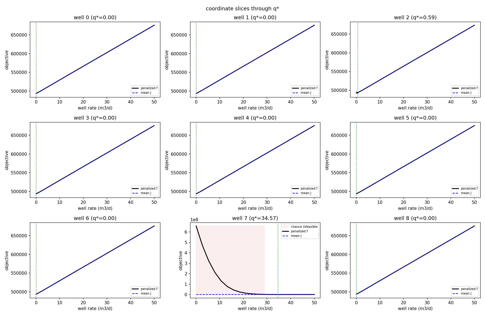
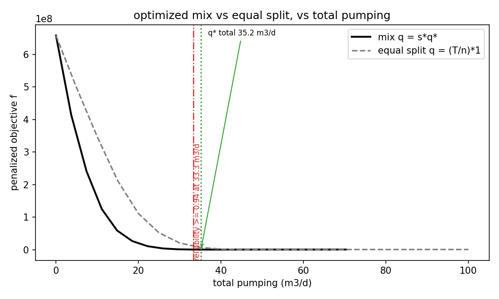
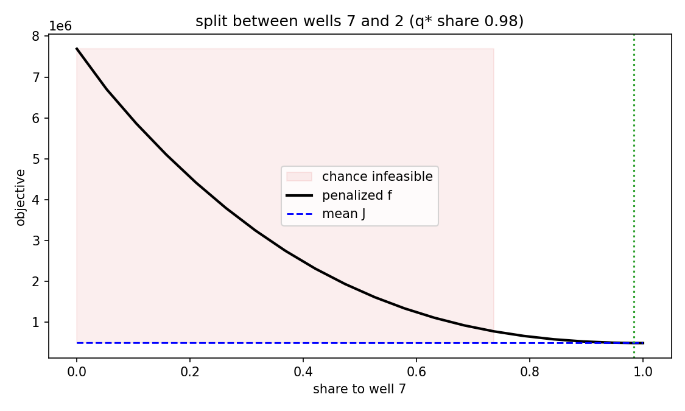

# 3D attribution: resolution vs backend at the paper preset

**Status:** complete (2026-11-27)
**Scripts:** `SCRIPTS/rescore_paper_candidates.py`, `SCRIPTS/verify_papergpu.py`
**Runs:** `out3d_colab/run_paper_torch/` (torch), `out3d_colab/run_paper_local/` (numpy)

## Question

The paper preset (32x16x8 = 4096 cells, numpy/splu) finds a **4-well / 50 m3/d**
design (test reliability 0.969). The paperGPU preset (64x32x16 = 32768 cells, torch
float32) finds **~1 well / 35 m3/d**. Those two runs differ in *both* resolution (8x
cells) and backend (numpy splu vs torch float32), so the shift could not be attributed
to either alone.

## Experiment

Re-ran the paper preset through the torch float32 backend on a T4
(`--preset paper --backend torch --dtype float32`, `--keep` + manual download). Well
placement was byte-for-byte identical to the numpy paper run (the same 9 wells), so
placement is ruled out as a confound.

## Result

| run | q* | train rel | test rel | train f |
|---|---:|---:|---:|---:|
| numpy 32x16x8 | wells 0-3 @ 12.5 = 50 m3/d | 1.0 | 0.969 | 547 606 |
| torch 32x16x8 | well 7 @ 24.96 m3/d | 0.984 | **0.914 (fails)** | 455 743 |

The torch optimizer found a *different* local minimum: cheaper on train, fragile on
test. The gate `test_reliability >= 1-alpha-1%` (0.94) fails.

## Decisive re-score (numpy/splu)

Both candidates re-scored on a single numpy archive at 32x16x8
(`SCRIPTS/rescore_paper_candidates.py`):

| candidate | train f | train rel | test f | test rel |
|---|---:|---:|---:|---:|
| `4well_50` (numpy paper) | 547 605.94 | 1.000 | 557 558.83 | 0.9688 |
| `1well_25` (torch paper) | 455 747.06 | 0.9844 | 639 489.09 | 0.9141 |

Two points fall out:

- **numpy reproduces the documented paper numbers exactly** (train 547 605.94, test
  547 665.31), so the re-score pipeline is correct.
- **numpy agrees with torch float32 on the 1-well solution to ~8e-6** (train f 455 747
  vs 455 743; test rel 0.9141 vs 0.9141). This is **not a float32 bug**.

## Conclusion

At 32x16x8 there are two *genuine* local minima:

- a **cheap-but-fragile** single south-edge well (25 m3/d) — looks excellent on 64
  training scenarios but overfits (test `cvar_G` jumps 0.016 -> 0.43, f -> 639 k);
- a **robust** 4-well design (50 m3/d) that generalizes (test rel 0.969).

The batched torch search landed in the former, the serial numpy search in the latter.
The divergence is SAA overfitting at M_train=64 plus search-path dependence, not
backend precision.

Resolution reconciles the two: at 64x32x16 the *same* south-edge strategy generalizes
(test rel 0.961, numpy-verified in `verify_splu.json`), so the fine grid is what makes
the south well trustworthy.

## Larger training sample (M_train=256)

Re-ran the paper preset with `--m-train 256` (256 train / 128 test, torch float32,
T4). The batched backend amortizes the 4x scenarios to only ~2x per-eval cost (2.45 s
vs 1.18 s at M=64).

| M_train | q* | train rel | test rel | test cvar_G | train f |
|---|---:|---:|---:|---:|---:|
| 64  | well 7 @ 24.96 | 0.984 | 0.914 (fails) | 0.43 | 455 743 |
| 256 | well 7 @ 26.05 | 0.973 | **0.945 (passes)** | 0.29 | 459 814 |

More data does **not** switch the optimizer to the robust 4-well basin --- the single
well is still ~88k cheaper on train. It makes the chosen single-well *honest*: with
αM = 12.8 tail draws (vs 3.2 at M=64) the violation is priced correctly, the rate
calibrates up (24.96 -> 26.05), and test reliability clears the gate (0.914 -> 0.945).
The 4-well design remains more robust (0.969) than the single-well (0.945); a larger
sample makes the cheap design honest, not robust.

## 1D slices (paperGPU q*)

Generated on a T4 (`--slices-only --q ...`), retrieved to
`out3d_colab/run_paperGPU_slices/slices1d/`, and browsable in the review app at
`/slices1d`:

- q* is a local minimum along every coordinate direction (7 inactive wells sit at 0).
- The chance constraint sits exactly at the boundary (rel 0.969, `cvar_G` 0.026).
- Concentration beats spreading: equal-split 35 m3/d gives rel 0.33 and needs ~50 m3/d
  to match q*.
- The "2-well" policy is effectively 1 well: the split slice improves to share=1.0
  (f 492 907 vs 493 556), so the 0.59 m3/d on well 2 is a step-size artifact.

