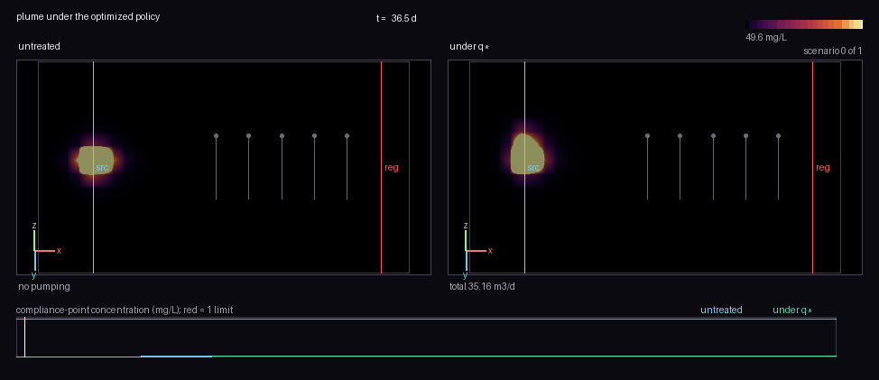
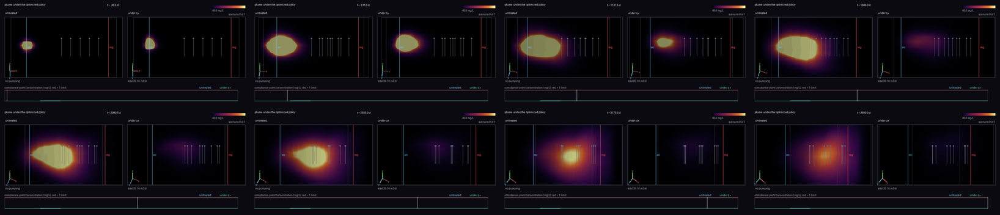
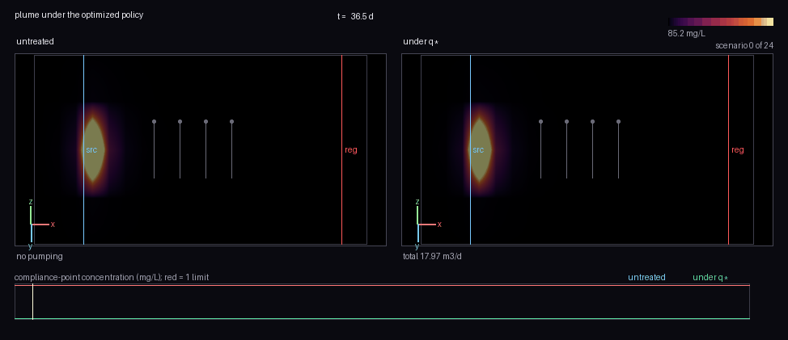

# GPU runs on Colab — the batched torch backend and `paperGPU`

This document records the first GPU runs of the batched PyTorch backend that is
now inlined in `full3D_colab_run.py` (`--backend torch`), and the `paperGPU`
preset that was added for it.  It is the 3D counterpart of `DOCS/GPU.md`
(which covers the 2D batched backend) and the run log that complements
`DOCS/3D_results.md` (which covers the NumPy/splu presets).

Everything below ran through the `colab` CLI from
[`google-colab-cli`](https://pypi.org/project/google-colab-cli/) on a **T4**
runtime, `torch 2.14.1+cu130`, `float32`.

---

## 1. What changed

`full3D_colab_run.py` gained a second backend without touching the validated
NumPy path:

| backend | solver | what it does |
| :--- | :--- | :--- |
| `--backend numpy` (default) | SciPy `splu` | exact reference; factorizes the TPFA Darcy matrix and the implicit-Euler transport matrix once each |
| `--backend torch` | batched CG / BiCGSTAB | same seven-point discretisation, matrix-free, batched over `S` candidates × `M` scenarios on one device |

The torch path keeps the same physics and the same SAA/CVaR objective; the only
difference is that one kernel launch advances `S*M` PDE solves instead of `S*M`
separate sparse LUs.  Darcy (SPD) uses batched CG; the implicit-Euler transport
(nonsymmetric) uses batched BiCGSTAB with warm starts and Jacobi
preconditioning.  The pattern search evaluates a whole `2*n_wells` compass sweep
in a single batched call.

New CLI surface: `--backend {numpy,torch}`, `--device auto|cuda|cpu`,
`--dtype float32|float64`, `--krylov-rtol`, `--krylov-maxiter`.
Krylov tolerances are `1e-11` in `float64` and `1e-5` in `float32`
(the float32 residual floor sits near `1e-6`, so `1e-5` is the honest choice).

---

## 2. How a run is sent to Colab

`full3D_colab_run.py` is single-file and self-contained (numpy/scipy/matplotlib
are preinstalled on Colab, as is a CUDA torch), so it can be sent as one file.

```bash
# one-time setup
pip install google-colab-cli
gcloud auth application-default login          # ADC, no keyring
# or, if ADC is unavailable (this machine):  colab auth
colab sessions --auth oauth2                    # smoke-test the auth

# the wrapper (T4, float32, 60 min, retrieves results + tears down)
python SCRIPTS/run_papergpu_colab.py --auth oauth2 --gpu T4 --budget 60
```

The wrapper expands to the reference one-liner:

```bash
colab --auth oauth2 run --gpu T4 --timeout 0 full3D_colab_run.py \
    --preset paperGPU --backend torch --dtype float32 --budget 60 --zip
```

`--timeout 0` is essential: `colab run` otherwise fails after 30 s *without
output*, and a quiet pattern-search sweep exceeds that.  On completion the CLI
retrieves the files the script wrote and stops the VM.

> Auth note: `SCRIPTS/run_papergpu_colab.py` defaults to `--auth adc`.  The
> runs here used `--auth oauth2` because this machine has no Application
> Default Credentials; the wrapper accepts `--auth` (or `COLAB_AUTH`).

---

## 3. Validation: `quick` on a T4 vs local CPU

Before spending an hour on `paperGPU`, the torch path was verified end-to-end on
the small `quick` preset (20×10×5, 1000 cells, M=12/24, 6 wells):

| run | backend / device | wall clock | f\* | test reliability |
| :--- | :--- | ---: | ---: | ---: |
| local | numpy / splu | 48.1 s | 399 221 | 0.958 |
| local | torch / cpu float64 | 86.5 s | 391 581 | 0.958 |
| **Colab** | **torch / T4 float32** | **7.9 s** | ≈ 3.92e5 | 0.958 |

All five gates pass in every row.  The GPU is **~6× faster than local numpy**
at this (tiny, latency-bound) size; the gap widens as the grid grows because
the batched stencil scales linearly in `nnz` while `splu` fill-in grows
superlinearly (see `DOCS/GPU.md`).

---

## 4. The `paperGPU` run on a T4

`paperGPU` is `paper` (32×16×8) refined 2× per axis: **64×32×16 = 32 768 cells**,
the same SAA size (M=64/128), the same 9 wells, the same 100 time steps.

| field | value |
| :--- | :--- |
| preset | `paperGPU` (64×32×16, nsteps=100, M=64/128, 9 wells, 3 starts) |
| backend | torch, `cuda`, Tesla T4, float32 |
| per-eval (calibrated) | 7.88 s |
| budget clamp | 3600 s → `max_evals` 400 → 152 per start |
| evaluations | 456 (batched compass sweeps) |
| wall clock | 4305 s (≈72 min; ~60 min optimizer + preamble/plots) |
| transport Krylov | converged, ~12.2 iterations/solve, no stalls |

**Policy and certificate**

| quantity | value |
| :--- | :--- |
| q\* | `[0, 0, 0.59, 0, 0, 0, 0, 34.57, 0]` m³/d (2 wells, 35.16 m³/d total) |
| train J | 492 896 |
| test J | 492 973 (train–test gap 1.6e-4) |
| test reliability | **0.961** (gate ≥ 0.94) |
| mean cleanup time | 141.2 d (no-pump: 3650 d) |
| mass-balance error | ≤ 1 % gate (torch float32) |

All five gates pass: KL retained variance ≥ 0.95, reproducible, mass balance,
test reliability, and improvement over no-pumping.

Two things stand out against `paper` on the NumPy path:

* On the refined grid the optimum moves from **4 equal wells** (`paper`:
  `q* = [12.5, 12.5, 12.5, 12.5, 0, …]`, total 50 m³/d) to **2 unequal wells**
  (35.16 m³/d).  More cells resolve the plume asymmetry, so the optimizer can
  concentrate the same work in fewer wells.
* `paperGPU` finishes an 8×-larger grid in ~72 min on a T4, while `paper`
  needed ~20 min for 4096 cells on a 4-core laptop — the crossover where the
  batched backend earns its keep.

---

## 5. Plume movies

Every run renders a rotating maximum-intensity projection of the plume
(specification in `DOCS/3D_movie.md`).  The frames show the same held-out
scenario under **no pumping** (left panel) and **q\*** (right panel).

### 5.1 `paperGPU` (re-rendered from the Colab run)





| final frame (scenario 0 of 128) | untreated | under q\* |
| :--- | ---: | ---: |
| peak concentration | 43.31 mg/L | **2.34 mg/L** |
| mean concentration | 2.865 mg/L | **0.074 mg/L** |
| cells above the 1 mg/L limit | 36.05 % | **1.51 %** |
| max fraction above the limit (over time) | 36.25 % | 5.21 % |

The movie matches the certificate: two wells (mostly one at 34.57 m³/d) pull
the plume back from the compliance point at x = 185 m, and the residual that
reaches it on the violating scenarios is the 3.9 % the certificate reports.

> **Colab render limitation.**  When `colab run` executes the script, the code
> runs with no `__file__`, so the in-run movie renderer fails with
> `NameError: name '__file__' is not defined` and only `movie3d_error.txt` is
> written.  The fix is the re-render path, which needs only the artifacts that
> were retrieved:
>
> ```bash
> python SCRIPTS/movie3d_from_policy.py --run out3d_colab/run_paperGPU --stride 2
> ```
>
> That is how the movie above was produced (two numpy re-solves on the same
> policy and geometry, ~20 s on a laptop).

### 5.2 numpy vs torch produce the same plume (`quick`)

The batched backend was built to reproduce the NumPy path, not to draw a
different picture.  Same policy geometry, same scenario:

| untreated / q\* — NumPy | untreated / q\* — torch (CPU float64) |
| :--- | :--- |
|  |  |

The two are visually identical to float64 tolerance (objective agreement was
~1e-12 on the parity tests in `tests/test_fv3d_torch_colab.py`).

---

## 6. Cross-preset summary

| run | backend | grid | wall | f\* | q\* (m³/d) | test reliability |
| :--- | :--- | :--- | ---: | ---: | :--- | ---: |
| quick | numpy | 20×10×5 | 48 s | 399 221 | 1.56 / 9.38 / 12.5 | 0.958 |
| quick | torch cpu | 20×10×5 | 87 s | 391 581 | 17.97 (1 well) | 0.958 |
| quick | **torch T4** | 20×10×5 | 8 s | ≈ 3.92e5 | 17.97 (1 well) | 0.958 |
| full | numpy | 24×12×6 | 879 s | 511 576 | 12.89 / 12.74 / 11.87 / 12.5 | 0.979 |
| paper | numpy | 32×16×8 | 1188 s | 547 606 | 12.5 ×4 | 0.969 |
| **paperGPU** | **torch T4** | 64×32×16 | 4305 s | 493 551 | 0.59 / 34.57 (2 wells) | 0.961 |

Artifacts: `out3d_colab/run_<preset>/` holds `metrics.json`, `policy.json`,
`run_config.json`, `movies/`, and (with `--zip`) `colab3d_results.zip`.
The `paperGPU` Colab run is at `out3d_colab/run_paperGPU/`.
