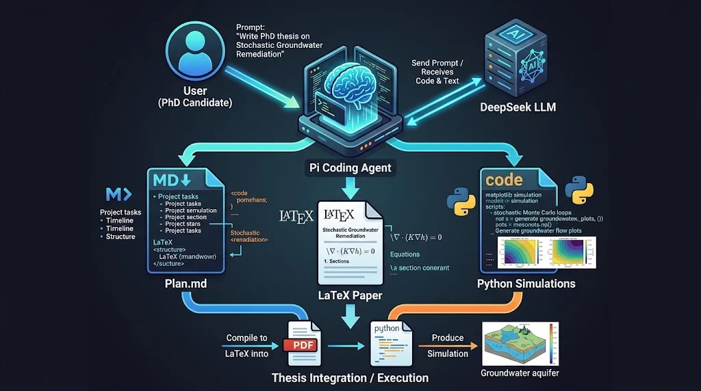

# TESIS — Physics-Informed Models for Groundwater Remediation

Research code for verifying and scaling PINN/FNO surrogates for groundwater
contaminant transport, and for stochastic pump-and-treat optimization under
uncertainty.

## Status

- **1D PINN verified** against the Ogata–Banks analytical solution:
  full-grid relative L2 `1.35e-2`, corner-excluded interior `8.0e-3`.
  The remaining error is the measure-zero inlet-corner singularity, not a bug.
- **2D forward chain** (finite-volume flow + transport, random log-normal `K`,
  wells, objective/mass balance) implemented; quick and full gate runs exist.
- **Stochastic optimization layer** implemented: KL random fields, well layout,
  SAA/CVaR chance constraints, discrete adjoint (gradient-checked), pattern
  search, reporting, and 32 passing unit tests.
- **Portability**: device/dtype selection, config manifests, resumable
  checkpoints, Dockerfiles, Colab runner, and a Flask figure viewer.

## Layout

Everything runnable lives in `SCRIPTS/` (see `SCRIPTS/USAGE.md`); the
repository root holds only the packages, configs, docs and outputs.

| Path | Contents |
|---|---|
| `SCRIPTS/` | All entry points and operations scripts — **see [`SCRIPTS/USAGE.md`](SCRIPTS/USAGE.md)** |
| `SCRIPTS/hydrology.py` | 1D ADE data generator and Ogata–Banks reference |
| `SCRIPTS/solve_1d_pinn.py` | 1D PINN solver (soft/hard BC, Adam + L-BFGS) |
| `SCRIPTS/solve_1d_fno.py` | 1D Fourier neural operator |
| `SCRIPTS/run_2d.py` | 2D forward/optimization driver |
| `SCRIPTS/run_optimization.py` | Stochastic optimization workflow and gates |
| `SCRIPTS/collab_run.py` | Colab/GPU dispatcher with `smoke`/`quick`/`full` presets |
| `SCRIPTS/multi_colab.py` | Multi-VM Colab driver (`launch`/`status`/`logs`/`collect`/`stop`) |
| `SCRIPTS/app.py` | Flask figure viewer + fleet dashboard (`/`, `/plots`, `/fleet`) |
| `physics/` | Finite-volume flow/transport and analytical references |
| `stoch/` | Random fields, wells, objective, SAA, chance, adjoint, optimizer, report |
| `configs/opt/` | Benchmark/exploration/certificate configurations |
| `tests/` | Unit and gradient-check tests (`python tests/run_tests.py`) |
| `NewPlan.md` | Fleet topology and bootstrap (Tailscale, Herdr) |
| `TEX/` | LaTeX formulation and plans |
| `plan.md`, `2D_plan.md`, `3D_plan.md` | Staged verification plans and gates |
| `optimization_plan.md` | Stochastic optimization execution plan |
| `Conclusions.md` | **Consolidated findings, with what is trustworthy and what is not** |
| `Actions.md`, `HUMAN.md`, `GROWTH.md` | Run log, handoff notes, scaling plan |

## Quick start

```bash
# Tests
python tests/run_tests.py

# 1D PINN (best known configuration)
python -u SCRIPTS/solve_1d_pinn.py --hard-bc --eps 1e-3 \
  --save-model out/pinn_hardbc_exp/model.pt --outdir out/pinn_hardbc_exp

# 2D quick forward + optimization
python -u SCRIPTS/run_2d.py --quick

# Stochastic optimization gates
python -u SCRIPTS/run_optimization.py --config configs/opt/benchmark_small.yaml

# Figure viewer + fleet dashboard (http://localhost:5001)
./SCRIPTS/run_app.sh start   # / and /plots for figures, /fleet for node health
```

On this machine use `/root/base/bin/python3`; the default `python3` has no
PyTorch. See `HUMAN.md` for environment gotchas and `Collab.md` for GPU/Colab
instructions.

## Next steps

1. Phase 3 PINN experiments: tau-ramp / RAR, longer Adam→L-BFGS schedule,
   gradient logging.
2. Phase 4 FNO: the coordinate-channel fix works (1.46% test rel L2, 15x better
   than the dataset-mean baseline); repeat the mode/resolution sweeps as
   medians over seeds. See `Conclusions.md`.
3. Complete the 2D gates G2.1–G2.5, then the 2.5D/3D gates G3.1–G3.6.
4. Run the full stochastic benchmark with out-of-sample reliability/cost
   certificates and CVaR/cleanup-time reporting.
5. Compile the LaTeX write-up and archive reproducible run manifests.

## Acknowledgements

This project was developed with assistance from the AI tools and run on
infrastructure and services from the platforms below.

### AI tools

<table>
  <tr>
    <td align="center" width="33%">
      <a href="https://gemini.google.com/">
        
      </a>
      <br>
      <a href="https://gemini.google.com/"><strong>Google Gemini</strong></a>
      <br>
      Research assistance, code review, and documentation support.
    </td>
    <td align="center" width="33%">
      <a href="https://pi.dev/">
        
      </a>
      <br>
      <a href="https://pi.dev/"><strong>Pi</strong></a>
      (<a href="https://github.com/earendil-works/pi">source</a>)
      <br>
      Implementation, testing, and repository maintenance.
    </td>
    <td align="center" width="33%">
      <a href="https://www.deepseek.com/">
        
      </a>
      <br>
      <a href="https://www.deepseek.com/"><strong>DeepSeek</strong></a>
      <br>
      Model assistance for code and analysis.
    </td>
  </tr>
</table>

### Platforms and services

<table>
  <tr>
    <td align="center" width="50%">
      <a href="https://www.digitalocean.com/">
        
      </a>
      <br>
      <a href="https://www.digitalocean.com/"><strong>DigitalOcean</strong></a>
      <br>
      Cloud droplets used for the remote 2D and optimization runs
      (<code>deploy_do.sh</code>, <code>remote_run.sh</code>).
    </td>
    <td align="center" width="50%">
      <a href="https://github.com/">
        
      </a>
      <br>
      <a href="https://github.com/"><strong>GitHub</strong></a>
      <br>
      Version control, release archives, and the GitHub CLI
      (<code>SCRIPTS/gh_setup.sh</code>).
    </td>
  </tr>
</table>

### Orchestration

[Herdr](https://herdr.dev) — terminal workspace manager for AI coding agents,
used for the hub's persistent sessions (`NewPlan.md`,
`SCRIPTS/fleet_bootstrap.sh`).

Gemini, Pi, DeepSeek, DigitalOcean, and GitHub are trademarks of their
respective owners; their logos are used here for identification only.
